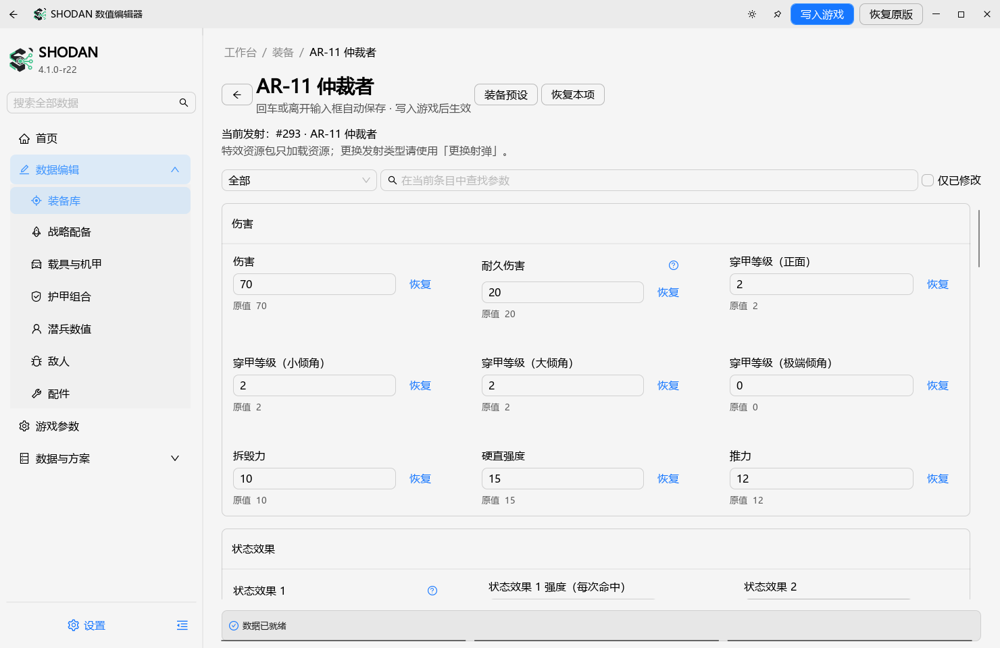
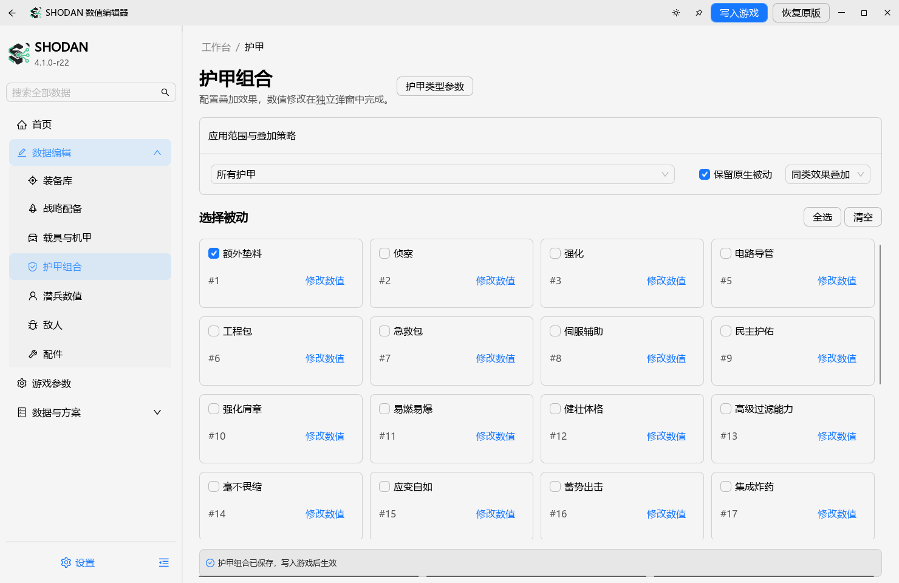
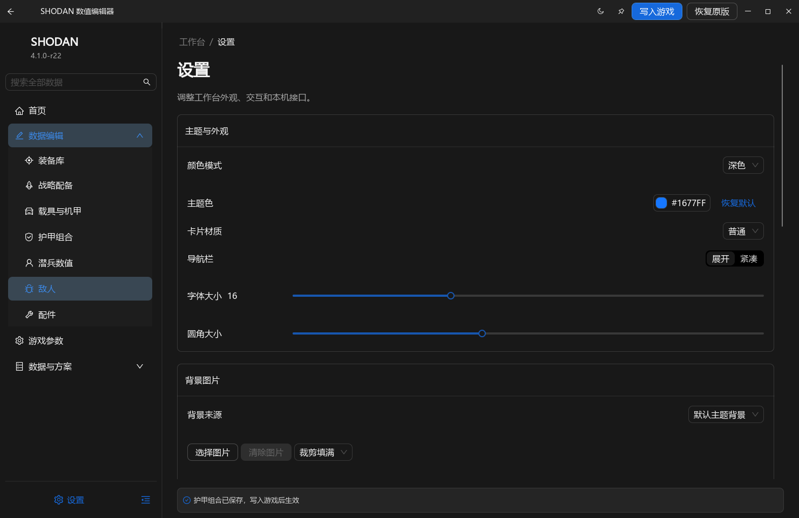

# SHODAN 数值编辑器

### 你的装备，你的参数，你的配置方案。

《绝地潜兵 2》中文离线数值编辑器 · Windows x64

**[下载最新版](https://github.com/127MU/SHODAN-Stat-Editor/releases/latest)** · [使用方法](#快速开始) · [功能一览](#功能一览) · [反馈问题](https://github.com/127MU/SHODAN-Stat-Editor/issues) · [特别鸣谢](#特别鸣谢)

真实桌面界面截图，取自 4.1.0-r22。配色、字号、背景和卡片材质可在设置中调整。

> [!TIP]
> **选择装备 → 调整参数 → 预览变化 → 写入游戏。**
> 发行包自带运行环境，无需额外安装 Python、Qt 或加载器。

## 快速开始

### ① 下载与运行

| 下载文件 | 使用方式 |
| --- | --- |
| `SHODAN_<版本>.exe` | 单文件版，直接运行；首次启动会释放内置运行文件 |
| `SHODAN_<版本>_Windows.zip` | 完整解压后运行 `SHODAN 数值编辑器.exe`，保留同目录文件 |
| `SHODAN_<版本>_Source.zip` | 对应源码，供开发与本地构建使用 |
| `SHA256SUMS.txt` | 用于核对下载文件的 SHA-256 校验值 |

### ② 选择内容并编辑

程序会通过 Steam 安装信息与库目录寻找游戏。打开左侧分类，按名称、型号或编号搜索，进入条目后修改参数。

**输入后按回车，或点击输入框外，即可确认数值。** 参数旁的“恢复”用于还原该项原值；有 `?` 的参数可悬停查看说明。“仅已修改”可以快速检查当前改动。

### ③ 预览并写入

关闭游戏，点击右上角 **“写入游戏”**，核对变化列表，再确认写入。等待窗口内的进度与结果提示，成功后重新启动游戏。

> [!IMPORTANT]
> 输入框确认、开关状态和保存预设，只代表编辑器已保存配置；普通数值修改仍需“写入游戏”后才会生效。
> **资源驻留和状态机补丁是独立操作**，会在选择模式并确认后立即处理，同样需要关闭游戏并在完成后重启。

## 功能一览

| 工作区 | 可以做什么 |
| --- | --- |
| 🎯 装备库 | 编辑主武器、副武器、支援武器、投掷物及可解析的强化增益 |
| 💥 弹丸与伤害 | 调整伤害、穿甲、弹药、初速、口径、重力、爆炸和状态效果；按名称或 ID 选择弹丸 |
| 🚀 战略配备 | 修改冷却、次数、呼叫指令、弹幕、空袭，以及对应的炮塔、背包和无人机参数 |
| 🚙 载具与机甲 | 编辑生命值、护甲、部件与挂载武器，同类关联条目集中展示；“挂载”栏的挂点（+8 / +16）为实验性功能，补给型载具（M-103）不开放挂点修改 |
| 🔭 武器配件 | 调整可解析的瞄具、枪口、下挂和弹药配件 |
| 🛡️ 护甲组合 | 多选被动，设置保留原生被动、叠加策略，并在弹窗中编辑可用数值 |
| 🧍 潜兵数值 | 调整生命值、部位、移动、耐力等现有可解析字段 |
| 👾 敌人与生成 | 查看敌人单位，以及支持的增援、巡逻与生成参数 |
| 🗂️ 数据库与预设 | 直接编辑弹丸、爆炸、电弧等记录；管理装备预设与全局方案 |
| 🎨 外观与设置 | 深浅主题、背景图片、字体、侧边栏、三列／四列、卡片材质与动画设置 |

页面按实际组件生成，**不是每件装备都拥有表中所有参数**。锁定、制导、喷流、过热、粘附等选项只会在对应记录存在时出现。

<b>🛡️ 看看护甲组合界面</b>

可为所有护甲或指定护甲组选择被动。组合选择与被动数值分开管理，数值编辑通过独立弹窗完成。

清空当前组不等于清空其他组；单独配置的护甲组会覆盖“所有护甲”的组合设置。

<b>🌙 看看深色与外观设置</b>

字体大小、背景图片、卡片材质和动画等设置可保存，重启后恢复。截图展示一种主题配置，实际效果还取决于你的设置与渲染环境。

## 编辑时需要了解的几件事

### 原值、共享参数与弹丸来源

- **原值**来自编辑器能够识别的原版基准；无法可靠映射时应显示未知，而不是把当前修改值冒充原值。
- **共享影响**会列出使用同一记录的武器或战备。修改一条共享伤害、爆炸或状态记录，可能同时影响多个装备。
- **特效资源包只负责加载资源**。要改变实际发射的弹丸，请使用弹丸选择，核对页面中的当前发射来源。
- **倍率与绝对值不同**：倍率 `1` 表示原比例，`2` 表示两倍；字段也可能使用秒、米、发或百分比，请看名称和说明。
- 数值需要符合底层存储类型。浮点数仍需是有限值，编号和枚举需要选择有效条目。

状态效果槽请连续使用；清空时从最后一个已使用的槽开始。更换效果后，核对施加强度及共享影响。

### 资源驻留与炮塔展开

资源驻留用于让所需模型、贴图、音效等资源随补丁加载，提供完整驻留和仅轻资源两种模式。轻资源模式会跳过带独立数据流的条目，可能缺少显示所需的资源。

支持的炮塔与工事可选择状态机资源，预览展开状态的修改，再安装或移除补丁。**修改的是对应资源，并非所有炮塔都能套用同一配方。** 同包多项修改需要保留在同一个补丁中，共享该资源的其他来源也可能受影响。

> [!WARNING]
> **状态机补丁为实验性功能**：少数工事与载具组合写入后可能依旧折叠、展开后又回卷，或部件显示错位。改前按“恢复”留原值，写入后重启游戏实测；出现异常就在同一栏选“移除补丁”回到原样。

同理，载具“挂载”栏的挂点值（+8 / +16）也是实验性字段：个别载具改完可能出现挂位错位或部件不显示，改前备份、改后实测。补给型载具（M-103 Supply FRV）的挂位与补给架绑定，面板不再提供这两行。

详细原理见 [资源驻留与状态机说明](docs/residency-and-state-machine.md)。

### 实验性参数与功能边界

“实验性”表示字段含义或游戏内效果仍需验证，离线读写测试通过不等于所有场景都已实测。标在栏目标题上的“（实验性功能）”表示该整项能力仍有稳定性反馈，上游修复前请当作试用。

“战略球更易附着表面”调整的是部分战备的导航网格部署限制，**不保证岩石、高台或任意表面都能黏附**。地狱舱转向速度和解除下落区域限制目前没有加入。

## 预设与恢复

**装备预设跟随当前选中的装备**，支持保存、读取、命名、导入和导出。全局预设用于保存多项装备与记录的修改方案，读取前可查看差异。

旧预设中无法识别的参数会显示兼容提示。导入后先核对装备、字段与原值，再写入游戏。

“恢复原版”用于恢复编辑器管理的游戏数据文件，**不会清空配置和预设**。游戏更新、Steam 校验或使用其他编辑工具后，建议重新打开编辑器读取当前文件，再继续修改。启动后文件被其他程序改变时，写入保护会要求重新检查。

## 设置、更新与 MCP

程序每次启动会在后台检查本仓库的最新正式发行版。有更新时弹窗展示版本与更新日志，可打开发行页或下载可用附件；不会自动替换正在运行的程序。`r` 表示本项目的修订版本。

<b>MCP 连接与调试接口</b>

默认关闭。设置中开启 MCP 后，复制连接配置到兼容客户端，并保持编辑器运行。

接口覆盖现有参数查询、编辑、预设、写入预览及恢复等后端能力；调试接口用于检查后端状态和调用结果。连接监听本机，会话端口和令牌会变化，退出或关闭开关后失效。不要公开分享带令牌的配置。

接口说明见 [MCP 文档](desktop/eui/MCP.md)。

## 常见问题

<b>没有找到游戏，或每个人安装路径不同怎么办？</b>

程序会查找 Steam 库，不要求固定盘符。自动查找失败时，可在设置中核对路径，或在配置目录的 `game folder.txt` 中填写自己的游戏根目录，保存后重新启动。

默认配置目录为 `%LOCALAPPDATA%\SHODAN\StatEditor`。单文件版在默认目录不可写时，可能使用程序旁的 `.SHODAN\Profile`；显式设置了 `SHODAN_PROFILE` 时以该目录为准。

<b>开启后没效果，或修改后游戏里没有变化？</b>

先确认写入成功，并已重新启动游戏。检查选中的记录是否属于当前装备、实际发射的弹丸及对应组件；共享参数和特效资源包不等于独立的装备替换。实验性字段需要单独验证效果。

<b>启动空白、没有窗口、写入失败或参数异常？</b>

先退出旧进程，使用最新完整发行包；ZIP 版必须完整解压。写入失败时检查报错路径、目录权限及游戏是否关闭。编辑期间使用过其他工具，请结束相关操作后重新打开编辑器。

反馈时请提供：程序版本、游戏 build、Windows 版本、具体装备与参数、操作步骤、截图及日志。日志通常位于当前配置目录的 `Logs` 中。不要直接删除原始备份来绕过错误。

[提交问题反馈](https://github.com/127MU/SHODAN-Stat-Editor/issues)

## 特别鸣谢

### [deepseekv41flash / hd2-datamined](https://github.com/deepseekv41flash/hd2-datamined)

感谢该项目公开整理《绝地潜兵 2》的离线数据研究、字段字典、行命名与本地化索引，以及弹丸引用链、资源加载和状态机等研究资料，为本项目核对字段、扩展功能和排查问题提供了重要依据。

**感谢持续分享研究过程、验证方法与工具，让后续开发能够建立在可核对的资料上。** 具体偏移和实验结论仍需按游戏 build 复验。

同时感谢：

- [SHODAN-HORAI / SHODAN-Stat-Editor](https://github.com/SHODAN-HORAI/SHODAN-Stat-Editor)：编辑器核心与上游功能。
- [CarbonAnime / SHODAN-Stat-Editor](https://github.com/CarbonAnime/SHODAN-Stat-Editor)：扩展功能与项目贡献。
- [HuskarUI](https://github.com/mengps/HuskarUI)：桌面组件、图标和主题系统。
- [hd2-srkit](https://github.com/deepseekv41flash/hd2-srkit) 与 [filediver](https://github.com/xypwn/filediver)：资源格式与解析相关的公开工具和资料。
- 提交代码、提供中文对照、测试报告和问题反馈的贡献者与用户。

## 构建与许可

界面采用 C++17、Qt Quick 和 HuskarUI，后端使用进程内 LuaJIT。开发构建需要 SDK；普通用户使用发行包即可。

[本地构建说明](desktop/huskar/BUILD.md) · [资源与状态机文档](docs/residency-and-state-machine.md) · [MCP 接口](desktop/eui/MCP.md)

本项目采用 **GPL-3.0**，详见 [LICENSE](LICENSE)。第三方组件遵循各自许可，发行包保留相应说明。
