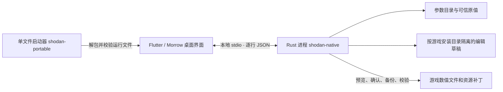

# SHODAN 开发指南

适用基线为 Windows x64 桌面版 **4.6.0-r2**，整理于 **2026-11-07（香港时间）**。本文用于搭建环境、定位代码和验证改动。版本来源、发布流程和故障接手见[维护交接手册](maintainer-handover.md)。

[程序结构](#一程序如何运行) · [构建与测试](#二从源码构建) · [修改规则](#三修改规则) · [提交检查](#四改动提交前)

## 一、程序如何运行



ZIP 版完整解压后可直接启动桌面程序。Flutter 负责界面、交互与任务状态，Rust 负责参数解析、数据校验、保存、安装与恢复。普通编辑先保存到编辑器工作区，点击「写入游戏」并确认后才进入游戏文件写入流程。资源驻留与状态机补丁有单独的确认入口，排查时先确认用户使用的是哪一个入口。

### 模块入口

| 问题或需求 | 先看这里 |
| --- | --- |
| 导航、目录、参数弹窗、搜索和全局任务入口 | [main.dart](../desktop/morrow/lib/main.dart)、[editor_tools.dart](../desktop/morrow/lib/editor_tools.dart) |
| 被动组合、被动数值弹窗、单件护甲 | [armor_page.dart](../desktop/morrow/lib/armor_page.dart)、[armor_item.dart](../desktop/morrow/lib/armor_item.dart)、[desktop_armor.rs](../rust/core/src/desktop_armor.rs)、[armor.rs](../rust/core/src/armor.rs) |
| 独立标题栏、缩放、最小化、快速退出 | [desktop_frame.dart](../desktop/morrow/lib/desktop_frame.dart)、[flutter_window.cpp](../desktop/morrow/windows/runner/flutter_window.cpp) |
| 玻璃材质、弹窗、拖动缩放时的效果 | [glass_theme.dart](../desktop/morrow/lib/glass_theme.dart)、[window_activity.dart](../desktop/morrow/lib/window_activity.dart)、[liquid_glass.dart](../desktop/morrow/lib/third_party/liquid_glass.dart) |
| Flutter 到 Rust 的调用、进度和错误分发 | [backend.dart](../desktop/morrow/lib/backend.dart)、[native_service.dart](../desktop/morrow/lib/native_service.dart)、[native_api.rs](../rust/core/src/native_api.rs) |
| 参数结构、存储编码、共享引用、撤销和草稿 | [catalog.rs](../rust/core/src/catalog.rs)、[catalog_edit.rs](../rust/core/src/catalog_edit.rs)、[catalog_refs.rs](../rust/core/src/catalog_refs.rs)、[workspace.rs](../rust/core/src/workspace.rs) |
| 装备与全局预设、分享码、旧配置迁移 | [preset_page.dart](../desktop/morrow/lib/preset_page.dart)、[desktop_presets.rs](../rust/core/src/desktop_presets.rs)、[preset_code.rs](../rust/core/src/preset_code.rs) |
| 原始值、游戏版本门禁、写入与恢复事务 | [baseline.rs](../rust/core/src/baseline.rs)、[game_workspace.rs](../rust/core/src/game_workspace.rs)、[install.rs](../rust/core/src/install.rs) |
| 资源身份、依赖与声音事件、补丁槽位 | [desktop_resources.rs](../rust/core/src/desktop_resources.rs)、[resource_resolver.rs](../rust/core/src/resource_resolver.rs)、[audio.rs](../rust/core/src/audio.rs)、[residency_install.rs](../rust/core/src/residency_install.rs) |
| 更新检查、本地 MCP、诊断脱敏 | [update.rs](../rust/core/src/update.rs)、[mcp.rs](../rust/core/src/mcp.rs)、[diagnostics.rs](../rust/core/src/diagnostics.rs) |
| Windows 单文件、发行附件、自动构建 | [shodan-portable.rs](../rust/core/src/bin/shodan-portable.rs)、[package_morrow.py](../tools/package_morrow.py)、[dev-build.yml](../.github/workflows/dev-build.yml) |

### 界面与原生进程的接口约定

界面调用 `Backend.call('方法名', [参数])`。传输层将它封装成 `desktop-call`，通过标准输入发送一行 JSON。响应使用同一个 `id` 对应请求，`ok` 决定读取 `result` 或 `error`。例如，打开工作区后可发出以下读取请求。

```json
{"id":1,"method":"desktop-call","params":{"name":"armor_rows","args":[1]}}
```

- 原生进程的标准输出只承载协议响应。安装进度经标准错误输出，使用 `@shodan-progress ` 前缀和 JSON 数据。调试输出走标准错误，避免破坏响应解析。
- `rows_fast` 供条目首屏读取，`rows_section` 按需读取分类，`rows_delta` 用于局部刷新。读取耗时资源时保留待检查状态，查询失败应与「未安装」区分。
- 多个参数可能绑定同一条底层记录。以目录中的唯一行键、记录身份和字段绑定定位参数。显示名与普通参数 ID 可以重复，搜索结果不能只凭这些名称归并。
- MCP 在设置中手动开启，绑定本机回环地址并使用临时令牌。新增接口时同步核对允许列表与写入边界。MCP 可以触发部分会话编辑或导出，但游戏文件安装仍由桌面流程控制。分享诊断时只分享脱敏后的导出。

## 二、从源码构建

### 环境

| 工具 | 要求 |
| --- | --- |
| Windows x64 | CI 使用 `windows-2022` |
| Visual Studio | 安装「使用 C++ 的桌面开发」工作负载及 Windows SDK，供 MSVC 和 Flutter Windows runner 使用 |
| Rust | 通过 rustup 安装，CI 固定 `1.99.1` |
| Flutter | Windows SDK，CI 固定 `3.47.9`，确保 `flutter doctor -v` 能找到 Windows 工具链 |
| Python | 打包脚本使用 `tomllib`，需要 Python 3.11 或以上。CI 使用 `fonttools==4.68.0` |
| GitHub CLI | 提交 PR、查看 Actions 或发布时使用。纯本地开发无需登录 GitHub |

版本以 [.github/workflows/dev-build.yml](../.github/workflows/dev-build.yml) 和各锁文件为准。正常构建使用仓库随附的参数目录与基准数据，运行包无需历史 Lua 宿主。首次构建需要获取依赖，游戏目录只在联调和离线集成回归时使用。

### 编译和单元测试

以下命令在 PowerShell 7 中从仓库根目录运行。

```powershell
$ErrorActionPreference = 'Stop'
$PSNativeCommandUseErrorActionPreference = $true

rustup toolchain install 1.99.1 --profile minimal
cargo +1.99.1 test --workspace --locked
cargo +1.99.1 build --workspace --release --locked

Push-Location desktop/morrow
try {
    flutter pub get --enforce-lockfile
    flutter test --no-pub
    flutter build windows --release --no-pub
} finally {
    Pop-Location
}
```

原生服务与单文件启动器位于 `target/release/`。Flutter 编译输出位于 `desktop/morrow/build/windows/x64/runner/Release/`，还需和参数目录、原值及原生服务一起组装，才能得到可独立使用的程序包。

构建找不到 MSVC 或 Windows SDK 时，先用 `flutter doctor -v` 核对 Visual Studio 工作负载。若 `LNK1104` 指向 `lnk*.tmp`，或 `flutter test` 报临时文件不可访问，先检查当前构建进程使用的临时目录是否可创建文件。缺少 `fontTools` 时，用运行打包脚本的同一个 Python 安装依赖。包输出路径已被占用时换新目录，便于保留和对比旧附件。

### 本地打包与检查

```powershell
python -m pip install fonttools==4.68.0
$stage = 'dist/SHODAN_dev_' + (Get-Date -Format 'yyyyMMdd_HHmmss')
python tools/package_morrow.py --output $stage

$portable = Resolve-Path -LiteralPath "${stage}_单文件.exe"
$check = Start-Process -FilePath $portable.Path -ArgumentList '--verify-package' -WindowStyle Hidden -Wait -PassThru
if ($check.ExitCode -ne 0) { throw '单文件包校验失败' }
Get-Item -LiteralPath $portable.Path, "${stage}.zip" | Select-Object Name, Length
```

打包输出包括运行目录、ZIP 和单文件 EXE。打包脚本要求使用新的输出名，检查字体图标和运行文件清单，生成 `manifest.json`，并要求 ZIP 和单文件 EXE 各小于 20,000,000 字节。单文件的 `--verify-package` 会校验并准备解包缓存，不启动编辑器。

以下命令检查 ZIP 的 CRC、文件清单及每项 SHA-256。用它核对刚生成的包，再完整解压试启动。

```powershell
@'
import hashlib
import json
import sys
from zipfile import ZipFile

with ZipFile(sys.argv[1]) as package:
    invalid = package.testzip()
    if invalid:
        raise SystemExit(f"ZIP CRC mismatch: {invalid}")
    manifest_path, = (name for name in package.namelist() if name.endswith("/manifest.json"))
    root = manifest_path.rsplit("/", 1)[0] + "/"
    manifest = json.loads(package.read(manifest_path))
    expected = {root + name for name in manifest["files"]} | {manifest_path}
    if len(expected) != len(package.namelist()) or expected != set(package.namelist()):
        raise SystemExit("ZIP entry list differs from the manifest")
    for name, digest in manifest["files"].items():
        if hashlib.sha256(package.read(root + name)).hexdigest() != digest:
            raise SystemExit(f"SHA-256 mismatch: {name}")
    print(manifest["version"], len(manifest["files"]), "files verified")
'@ | python - "${stage}.zip"
```

### 使用隔离数据进行集成回归

需要一份与参数目录匹配的游戏安装。将下面的 Steam 路径替换成实际安装位置，保留 `data/game` 后缀。脚本复制会被改写的游戏数据表，以硬链接引用 `bundles*.nxa` 作为只读资源来源，并为测试设置独立的 `SHODAN_PROFILE`。因此 `$isolated` 与游戏数据必须位于支持硬链接的同一卷。真实游戏目录只作为数据来源。

```powershell
$gameData = 'D:/SteamLibrary/steamapps/common/Helldivers 2/data/game'
$isolated = 'dist/native-desktop-qa-' + (Get-Date -Format 'yyyyMMdd_HHmmss')
python tests/test_native_desktop.py --exe target/release/shodan-native.exe --runtime $stage --game-data $gameData --output $isolated
```

这项回归包含被动数值保存后重启读取、预设往返、诊断脱敏、安装与恢复、资源驻留等。它检查工具行为、配置及文件结果。游戏中的音效、特效和复杂挂载仍需按具体装备在对应版本中验证。其他脚本的夹具参数用各自的 `--help` 确认，部分 `test_native_*.py` 依赖单独的历史审计目录。

## 三、修改规则

### 参数与游戏版本

- [参数目录](../rust/core/data/catalog.json.gz) 提供条目、字段类型、引用和游戏指纹。[原值参考](../offline/originals/) 与嵌入的护甲基准提供可信来源。运行时从当前数据读取工作值，并独立校验参考数据。
- **原值、打开时的文件值、待写入值**是三个不同概念。第三方工具留下的数值只可作为当前文件状态。无法验证的原值应显示为未知，恢复操作需要可信来源。
- Rust 打开游戏工作区时比对 `game.dll` 的 SHA-256，安装前再次检查。适配新 build 时同步核对记录身份、组件布局、相对偏移、位域和存储类型。旧文档的绝对偏移只适用于其记录的版本。
- 目录内容可离线读写时，仍要区分「字段存在」「写入后回读一致」「游戏内效果可见」。日志、截图和测试记录注明达到哪一级。
- 浮点数的显示舍入只放在 UI。新字段用 Rust 的存储类型校验有限性、整数宽度与引用有效性，避免未改动的值因显示格式发生回写。

查看随包目录的元数据与游戏指纹可以使用下列命令，无需解封游戏文件。

```powershell
python -c "import gzip,json; c=json.load(gzip.open('rust/core/data/catalog.json.gz')); print(c['format'], c['version'], c['game_build']); print(len(c['owners']),len(c['fields']))"
Get-FileHash -Algorithm SHA256 -LiteralPath "$gameData/game.dll"
```

历史迁移脚本 [export_native_catalog.py](../tools/export_native_catalog.py) 需要单独的 `--reference-tree` 和对应参考数据。已有迁移清单时，[compile_native_catalog.py](../tools/compile_native_catalog.py) 接收 `--inventory` 和 `--output` 生成候选目录与审计结果。先输出到独立目录核对，再替换随包文件。常规开发直接使用已提交的目录，无需运行这两个脚本。

### 常见改动如何验收

| 改动 | 开发验收 |
| --- | --- |
| 增加一个武器、潜兵或载具数值 | 记录适用 build 和字段来源。核对读值、实际存储类型、原值、共享影响、预设往返、写入与恢复。换条目后检查当前上下文是否仍正确 |
| 修改护甲被动 | 从「修改数值」编辑后直接点关闭，再打开核对。覆盖回车、离焦、恢复原值及保存失败重试。重启数据进程后检查草稿，再验证与护甲组合或全局预设一起读取 |
| 修改标题栏或弹窗 | 保持窗口控件处在页面 Navigator 外层。验证打开弹窗时按钮仍可点击、最大化与还原文案正确、缩放时输入状态保留。至少补一次目标 Windows 环境手测 |
| 修改资源选择或驻留 | 核对资源类型与完整 ID、来源包、目标补丁槽位、主文件及所需伴生数据。验证预览、重复安装、移除和外部修改冲突。粒子、模型与音效分别记录实机结果 |
| 修改更新检测或 MCP | 验证本地关闭和失败分支，发行版本排序、更新日志、附件链接及令牌脱敏。下载入口使用正式发行附件地址 |

### 写入事务的边界

写入先核对游戏是否已退出、当前版本及目标文件是否仍符合预期，再准备写入、创建备份与事务日志、提交并记录成功。遇到中断后按日志恢复，已改变的外部文件或损坏的备份必须显示错误。新增写入点应走已有事务路径，测试覆盖预览取消、外部冲突、重复执行与恢复。详情见[交接手册的故障排查](maintainer-handover.md#四故障排查)。

### 追踪一笔护甲被动编辑

1. 在 `armor_page.dart` 的被动弹窗找 `armor_rows` 返回的唯一字段键。记录原值和当前值，确认两者来源不同。
2. 观察 `armor_set` 是否发出，检查返回错误或保存失败提示。弹窗退出等待最后一次提交完成，避免控件销毁前丢失输入。
3. `desktop_armor.rs` 验证字段属于所选被动，更新 Rust 工作区中的护甲数值快照。快照与其他编辑元数据一起持久化到该安装目录对应的草稿。
4. 重新请求 `armor_rows`，再重启原生进程读回。两次读回都应得到新值。恢复按钮应取可信原值，恢复后重新打开也要一致。
5. 在隔离数据副本中检查写入预览、安装结果和恢复结果。只做前四步时，可确认工作区保存，尚未验证游戏文件写入。

## 四、改动提交前

1. 先确认功能属于当前 Rust/Flutter 运行链，按模块表定位入口。
2. 检查变更是否影响原值、预设、共享引用、安装恢复或旧配置兼容；把实际受影响的用例写进 PR。
3. 运行相关单元测试。涉及数据写入、配置迁移或资源补丁时，加跑隔离集成回归。
4. 检查 `git status --short`、`git diff --check` 和暂存清单。构建目录、配置、诊断日志、资源包和本地试验数据留在本机。
5. 按[交接手册](maintainer-handover.md)记录验证边界。历史设计可以参考[纯 Rust 迁移说明](pure-rust-migration.md)和[资源驻留与状态机](residency-and-state-machine.md)，其中涉及旧界面或旧游戏 build 的内容需要按现行源码复核。
